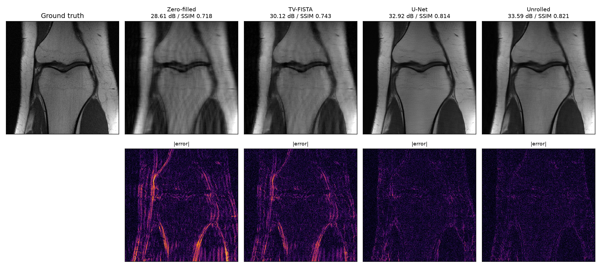
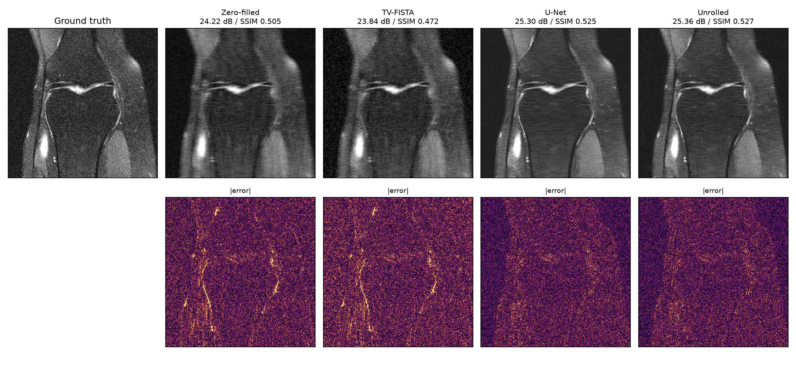
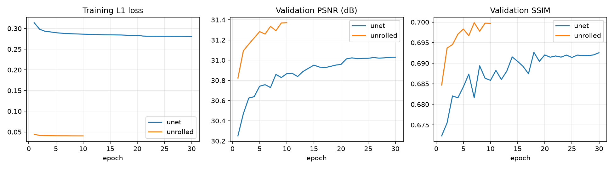
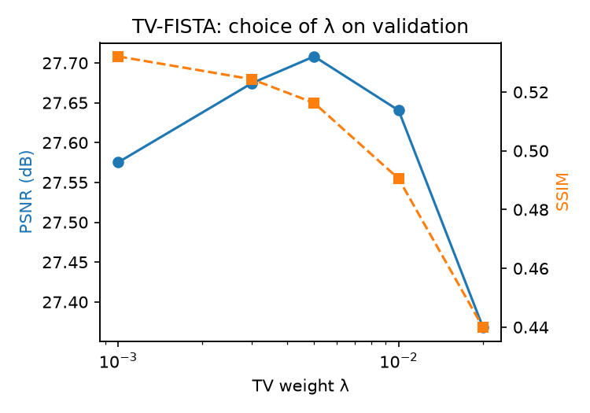

# Accelerated MRI reconstruction: model-based optimisation vs deep learning

Reconstruction of knee MR images from **4x undersampled k-space** (fastMRI single-coil),
comparing a classical compressed-sensing method with two deep learning approaches
under exactly the same data, masks and metrics.

| Method               | Type                      | Idea                                                                                  |
| -------------------- | ------------------------- | ------------------------------------------------------------------------------------- |
| **Zero-filled**      | baseline                  | inverse FFT of the measured k-space, missing lines set to 0                           |
| **TV-FISTA**         | model-based optimisation  | total-variation regularised least squares solved with FISTA                           |
| **U-Net**            | data-driven, image domain | learns to remove aliasing from the zero-filled image                                  |
| **Unrolled network** | physics + learning        | unrolls a proximal-gradient algorithm, replacing the TV prior with small learned CNNs |

**Main result:** on 30 held-out test volumes, the unrolled network gives the best reconstructions
(PSNR 31.76 dB, SSIM 0.721), ahead of a U-Net (31.27 dB, 0.712) that has **2.7x more parameters**
and was trained for **3x more epochs**. Building the acquisition physics into the network makes
learning more efficient. TV regularisation barely improves on zero-filling for knee images.



## Problem

An MRI scanner measures the Fourier transform of the image (k-space). Acquiring only one
phase-encoding line in _R_ (acceleration factor _R_) shortens the scan by _R_, but the inverse
problem becomes ill-posed:

```math
y = M F x + \varepsilon
```

where $x$ is the complex image, $F$ the 2D Fourier transform, $M$ the binary sampling mask and
$y$ the measured k-space. Zero-filling ($x = F^H y$) produces aliasing artefacts (the vertical
streaks in the error maps below), so a prior on $x$ is needed.

### TV-FISTA (model-based)

```math
\hat x = \arg\min_x \frac{1}{2} \lVert M F x - y \rVert_2^2 + \lambda \, \mathrm{TV}(x)
```

- The data term has an $L = 1$ Lipschitz gradient (unitary $F$, binary $M$), so the step size is exactly 1.
- The proximal operator of the isotropic TV has no closed form; it is computed with the
  **Fast Gradient Projection** algorithm on the dual problem (Beck & Teboulle, 2009),
  warm-started across FISTA iterations.
- $\lambda$ is selected on the **validation** set (`scripts/tune_tv.py`), never on test.

### U-Net (image domain)

The fastMRI baseline U-Net (4 pooling levels, 32 base channels, 7.76 M parameters) maps the
normalised zero-filled magnitude image to the target, with an L1 loss.

### Unrolled proximal-gradient network

```math
x_{k+1} = x_k - \eta_k \, A^H (A x_k - y) - R_{\theta_k}(x_k), \qquad A = M F
```

Each of the $K = 6$ cascades takes an exact gradient step on the data term (the acquisition
physics is built in), with a learned step size $\eta_k$, followed by a small U-Net
$R_{\theta_k}$ acting on the real and imaginary channels (2.89 M parameters in total).
It has the same structure as the optimisation algorithm, but the prior is learned from data.

## Results

fastMRI single-coil knee, 4x random Cartesian undersampling (8 % fully sampled centre).
Test set: 30 held-out volumes (1048 slices). Metrics per volume, mean ± std across volumes.

| Method               | PSNR (dB)        | SSIM                | NMSE       | Parameters | Epochs | Time / slice (T4 GPU) |
| -------------------- | ---------------- | ------------------- | ---------- | ---------- | ------ | --------------------- |
| Zero-filled          | 29.14 ± 2.55     | 0.6489 ± 0.1141     | 0.0490     | 0          | –      | 0.002 s               |
| TV-FISTA (λ = 0.001) | 29.32 ± 2.99     | 0.6316 ± 0.1287     | 0.0504     | 0          | –      | 0.35 s                |
| U-Net                | 31.27 ± 3.12     | 0.7121 ± 0.1260     | 0.0335     | 7.76 M     | 30     | 0.012 s               |
| Unrolled (K = 6)     | **31.76 ± 3.45** | **0.7207 ± 0.1290** | **0.0315** | 2.89 M     | 10     | 0.064 s               |

**Observations**

- **Both networks clearly outperform the classical methods**: +2.1 to +2.6 dB PSNR and about
  +0.07 SSIM over zero-filling. The error maps show that they remove most of the aliasing streaks.
- **The unrolled network is best on every metric** (+0.49 dB PSNR over the U-Net) with 2.7x fewer
  parameters and a third of the training epochs.
- **TV-FISTA barely improves on zero-filling.** It raises PSNR slightly but lowers SSIM, because
  piecewise-constant regularisation smooths the fine texture of bone and cartilage. On validation,
  PSNR peaks at λ = 0.005 while SSIM keeps decreasing as λ grows (see below).
- **The large standard deviations come from differences between volumes**, not from instability.
  fastMRI knee contains two contrasts:
  - **proton density (PD)** images have high signal-to-noise ratio, and the networks gain up to
    5 dB over zero-filling (33.6 dB vs 28.6 dB on the example above);
  - **fat-suppressed (PD-FS)** images are much noisier, _including the fully sampled ground truth_.
    All methods score lower (22–25 dB), the error maps are dominated by noise, and the networks
    produce smoother images than the noisy reference. PSNR/SSIM against a noisy target
    underestimates their visual quality on these volumes.

### Examples (test volumes, middle slice)

PD-FS contrast (noisy ground truth): the networks remove the aliasing but cannot, and should not,
reproduce the noise of the reference.




### Training curves (validation set, 10 volumes)



- The unrolled network exceeds the U-Net's final validation PSNR (31.03 dB after 30 epochs) from
  its **second epoch**, and reaches 31.37 dB after 10 epochs.
- The U-Net levels off after about 15 epochs; lowering the learning rate at epoch 20 adds less than 0.1 dB.
- The two training losses are **not on the same scale**: the U-Net loss is computed on
  mean/std-normalised images, the unrolled loss on images scaled by their maximum. Only the
  validation metrics can be compared.
- Training time per epoch: U-Net about 2 h on CPU; unrolled network about 8.5 h on CPU and 24 min on
  a Colab T4 GPU (3 epochs on CPU, then resumed for 7 on GPU with `--resume`).

### Choice of the TV weight (validation, 3 volumes)



λ = 0.005 maximises PSNR, but SSIM decreases monotonically with λ. Checkpoints of the networks are
selected by SSIM, so the same criterion was used for TV (λ = 0.001). The absolute values are lower
than on the test set because these 3 validation volumes are harder than average.

## Evaluation protocol

- Split **by volume** with a fixed seed: no slice of a test patient is seen during training.
- Validation and test masks are **deterministic per volume**, so every method sees exactly the same
  undersampling; training masks are redrawn every epoch (augmentation).
- Metrics follow the fastMRI convention: computed on the 320 × 320 magnitude image, per volume,
  with the data range set to the volume maximum.
- Hyperparameters (TV λ, network checkpoints) are selected on validation only.
- Running the evaluation on CPU and on GPU gave identical metrics for zero-filling, TV and the U-Net,
  which confirms that the evaluation is reproducible.

## Limitations

- Training data: 139 volumes from the fastMRI validation release (the official baseline used about
  970 training volumes), so absolute scores are below published fastMRI baselines.
- One acceleration factor (4x) and one mask type; one training run (seed) per model.
- The gap between the unrolled network and the U-Net (+0.49 dB) is smaller than the spread between
  volumes; a paired per-volume comparison would make the comparison more rigorous.
- PSNR and SSIM against noisy fat-suppressed references are imperfect measures of image quality.

## Next steps

- Paired per-volume statistics (the per-volume metrics are saved in `results/test/per_volume_*.json`)
- Several acceleration factors (4x, 8x) and equispaced masks
- Training the unrolled network for longer (learning-rate decay at epoch 15)
- Plug-and-play FISTA with the trained network as denoiser
- Robustness to mask and contrast changes (domain shift), and uncertainty estimation

## Project structure

```
mri-reconstruction/
├── configs/                 # YAML configs (data paths, mask, model, training)
├── scripts/
│   ├── split_data.py        # train/val/test split by volume (no patient leakage)
│   ├── tune_tv.py           # choose lambda for TV-FISTA on validation
│   ├── train.py             # train U-Net or unrolled network (--resume supported)
│   ├── evaluate.py          # compare all methods on the test set
│   ├── make_figures.py      # comparison images, error maps, learning curves
│   └── make_synthetic_data.py  # tiny fake fastMRI files for tests
├── src/mrirecon/
│   ├── fft.py               # centred orthonormal FFTs, forward/adjoint operators
│   ├── masks.py             # random / equispaced Cartesian masks
│   ├── data.py              # fastMRI HDF5 slice dataset
│   ├── classical.py         # zero-filling, TV prox (FGP), TV-FISTA
│   ├── models/              # U-Net, unrolled network
│   ├── metrics.py           # NMSE, PSNR, SSIM per volume (fastMRI convention)
│   ├── reconstruct.py       # common interface: k-space batch -> 320x320 image
│   └── train.py, evaluate.py
├── figures/                 # figures used in this README
└── tests/                   # unit tests (adjoint checks, TV, shapes, resume) + end-to-end run
```

## Setup

```bash
python -m venv .venv
source .venv/bin/activate          # Windows PowerShell: .\.venv\Scripts\Activate.ps1
pip install -r requirements.txt
pip install -e .
pytest                             # ~1 min, runs on synthetic data
```

## Data

1. Request access to fastMRI at <https://fastmri.med.nyu.edu/> and download the **knee single-coil
   validation** data (`knee_singlecoil_val.tar`, 199 volumes, 14.9 GB).
2. Extract it into `data/` (the data are not included in this repository):

   ```bash
   python -c "import tarfile; tarfile.open('data/knee_singlecoil_val.tar', 'r:*').extractall('data/')"
   ```

3. Split the volumes into train / validation / test (139 / 30 / 30 volumes):

   ```bash
   python scripts/split_data.py --data-root data/singlecoil_val --out data/splits.json
   ```

The official fastMRI test set has no ground truth, so this project builds its own held-out test set
from volumes with `reconstruction_esc` targets.

## Usage

```bash
# 1. Choose the TV weight on validation volumes, then set tv.lam in configs/evaluate.yaml
python scripts/tune_tv.py --config configs/evaluate.yaml --lams 0.001 0.003 0.005 0.01 0.02

# 2. Train the networks
python scripts/train.py --config configs/unet.yaml
python scripts/train.py --config configs/unrolled.yaml

# 3. Evaluate everything on the test volumes
python scripts/evaluate.py --config configs/evaluate.yaml

# 4. Figures for this README
python scripts/make_figures.py --results results/test --runs runs/unet runs/unrolled --tv-tuning results/tv_tuning.csv
```

Training can be interrupted and resumed from the last saved epoch (`runs/<model>/last.pt`);
`train.epochs` is the _total_ number of epochs:

```bash
python scripts/train.py --config configs/unrolled.yaml --resume --set train.epochs=10
```

Any config value can be overridden from the command line, e.g. a quick CPU run:

```bash
python scripts/train.py --config configs/unet.yaml --set model.chans=16 data.max_train_volumes=15 train.epochs=5
```

## References

- Zbontar et al. (2018). _fastMRI: An Open Dataset and Benchmarks for Accelerated MRI_. arXiv:1811.08839.
- Beck & Teboulle (2009). _Fast gradient-based algorithms for constrained total variation image denoising and deblurring problems_. IEEE TIP.
- Beck & Teboulle (2009). _A fast iterative shrinkage-thresholding algorithm for linear inverse problems_. SIAM J. Imaging Sciences.
- Lustig, Donoho & Pauly (2007). _Sparse MRI: The application of compressed sensing for rapid MR imaging_. MRM.
- Ronneberger, Fischer & Brox (2015). _U-Net: Convolutional networks for biomedical image segmentation_. MICCAI.
- Hammernik et al. (2018). _Learning a variational network for reconstruction of accelerated MRI data_. MRM.
- Aggarwal, Mani & Jacob (2019). _MoDL: Model-based deep learning architecture for inverse problems_. IEEE TMI.
