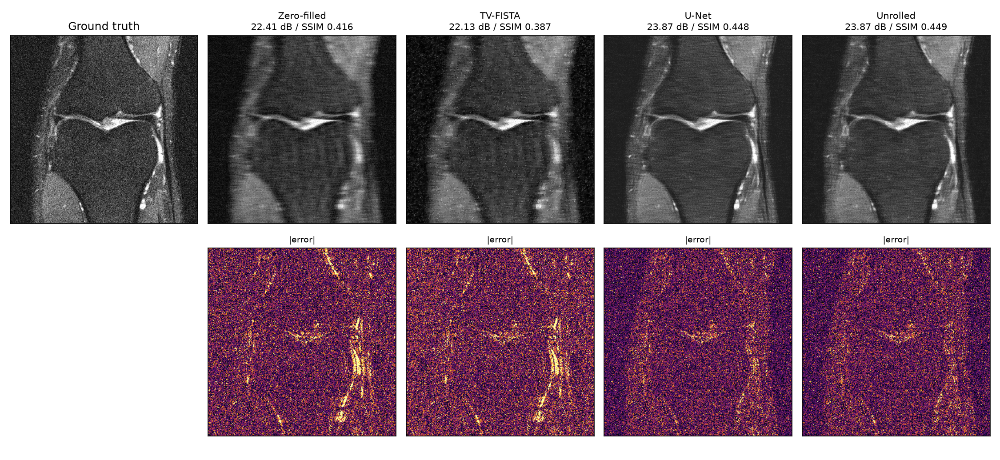

# Accelerated MRI reconstruction: model-based optimisation vs deep learning

Reconstruction of knee MR images from **undersampled k-space** (fastMRI single-coil),
comparing a classical compressed-sensing method with two deep learning approaches
under exactly the same data, masks and metrics:

| Method               | Type                      | Idea                                                                                  |
| -------------------- | ------------------------- | ------------------------------------------------------------------------------------- |
| **Zero-filled**      | baseline                  | inverse FFT of the measured k-space, missing lines set to 0                           |
| **TV-FISTA**         | model-based optimisation  | total-variation regularised least squares solved with FISTA                           |
| **U-Net**            | data-driven, image domain | learns to remove aliasing from the zero-filled image                                  |
| **Unrolled network** | physics + learning        | unrolls a proximal-gradient algorithm, replacing the TV prior with small learned CNNs |

> Status: work in progress. Results below will be updated as experiments run.

## Problem

An MRI scanner measures the Fourier transform of the image (k-space). Acquiring
only one line in _R_ (acceleration factor _R_) shortens the scan by _R_, but the
inverse problem becomes ill-posed:

$$ y = M F x + \varepsilon $$

where $x$ is the complex image, $F$ the 2D Fourier transform, $M$ the binary
sampling mask and $y$ the measured k-space. Zero-filling ($x = F^H y$) produces
aliasing artefacts, so a prior on $x$ is needed.

### TV-FISTA (model-based)

$$ \hat x = \arg\min_x \tfrac12 \lVert M F x - y \rVert_2^2 + \lambda \, \mathrm{TV}(x) $$

- The data term has an $L = 1$ Lipschitz gradient (unitary $F$, binary $M$), so
  the step size is exactly 1.
- The proximal operator of the isotropic TV has no closed form; it is computed
  with the **Fast Gradient Projection** algorithm on the dual problem (Beck &
  Teboulle, 2009), warm-started across FISTA iterations.
- $\lambda$ is selected on the **validation** set (`scripts/tune_tv.py`), never on test.

### U-Net (image domain)

The fastMRI baseline U-Net (4 pooling levels, 32 base channels, ~7.8 M
parameters) maps the normalised zero-filled magnitude image to the target, with an L1 loss.

### Unrolled proximal-gradient network

$$ x*{k+1} = x_k - \eta_k \, A^H(A x_k - y) - R*{\theta_k}(x_k), \qquad A = MF $$

Each of the _K_ cascades takes an exact gradient step on the data term (the
acquisition physics is built in), with a learned step $\eta_k$, followed by a
small U-Net $R_{\theta_k}$ acting on the real and imaginary channels. This links
the two worlds: it has the same structure as the optimisation algorithm, but the
prior is learned from data.

## Project structure

```
mri-reconstruction/
├── configs/                 # YAML configs (data paths, mask, model, training)
├── scripts/
│   ├── split_data.py        # train/val/test split *by volume* (no patient leakage)
│   ├── tune_tv.py           # choose lambda for TV-FISTA on validation
│   ├── train.py             # train U-Net or unrolled network
│   ├── evaluate.py          # compare all methods on the test set
│   ├── make_figures.py      # comparison images, error maps, learning curves
│   └── make_synthetic_data.py  # tiny fake fastMRI files for tests
├── src/mrirecon/
│   ├── fft.py               # centred orthonormal FFTs, forward/adjoint operators
│   ├── masks.py             # random / equispaced Cartesian masks
│   ├── data.py              # fastMRI HDF5 slice dataset
│   ├── classical.py         # zero-filling, TV prox (FGP), TV-FISTA
│   ├── models/              # U-Net, unrolled network
│   ├── metrics.py           # NMSE, PSNR, SSIM per volume (fastMRI convention)
│   ├── reconstruct.py       # common interface: k-space batch -> 320x320 image
│   ├── train.py, evaluate.py
└── tests/                   # unit tests (adjoint checks, TV, shapes) + end-to-end run
```

## Setup

```bash
python -m venv .venv
source .venv/bin/activate(.\.venv\Scripts\Activate.ps1)        # Windows: .venv\Scripts\activate
pip install -r requirements.txt
pip install -e .
pytest                           # ~1 min, runs on synthetic data
```

## Data

1. Request access to fastMRI at <https://fastmri.med.nyu.edu/> and download the
   **knee single-coil** data (`knee_singlecoil_val.tar` is enough to start).
2. Extract the archive into `data/` (the data are not included in this repository):
   ```bash
   mkdir -p data && python -c "import tarfile; tarfile.open('data/knee_singlecoil_val.tar', 'r:*').extractall('data/')"
   ```
3. Split the volumes into train / validation / test (139 / 30 / 30 %, by volume):
   ```bash
   python scripts/split_data.py --data-root data/singlecoil_val --out data/splits.json
   ```

The official fastMRI test set has no ground truth, so this project builds its own
held-out test set from volumes with `reconstruction_esc` targets.

## Usage

```bash
# 1. Choose the TV weight on validation volumes
python scripts/tune_tv.py --config configs/evaluate.yaml --lams 0.001 0.003 0.005 0.01 0.02
#    -> then set tv.lam in configs/evaluate.yaml

# 2. Train the networks
python scripts/train.py --config configs/unet.yaml
python scripts/train.py --config configs/unrolled.yaml

# 3. Evaluate everything on the test volumes
python scripts/evaluate.py --config configs/evaluate.yaml

# 4. Figures for this README
python scripts/make_figures.py --results results/test --runs runs/unet runs/unrolled
```

Any config value can be overridden from the command line, e.g. a quick CPU run:

```bash
python scripts/train.py --config configs/unet.yaml --set model.chans=16 data.max_train_volumes=15 train.epochs=5
```

## Results

4x random Cartesian undersampling, 8 % fully sampled centre, metrics per volume
(mean ± std over test volumes).

| Method           | PSNR (dB) | SSIM | NMSE | Parameters | Time / slice |
| ---------------- | --------- | ---- | ---- | ---------- | ------------ |
| Zero-filled      | –         | –    | –    | 0          | –            |
| TV-FISTA (λ = …) | –         | –    | –    | 0          | –            |
| U-Net            | –         | –    | –    | 7.8 M      | –            |
| Unrolled (K = 6) | –         | –    | –    | –          | –            |



## Evaluation protocol

- Split **by volume**, fixed seed: no slice of a test patient is seen in training.
- Validation and test masks are **deterministic per volume**, so every method sees
  exactly the same undersampling; training masks are redrawn each epoch (augmentation).
- Metrics follow the fastMRI convention: computed on the 320 × 320 magnitude image,
  per volume, with the data range set to the volume maximum.
- Hyperparameters (TV λ, network checkpoints) are selected on validation only.

## Next steps

- Several acceleration factors (4x, 8x) and equispaced masks
- Plug-and-play FISTA with the trained denoiser as prior
- Robustness to mask and contrast changes (domain shift)
- Uncertainty estimation of the reconstructions

## References

- Zbontar et al. (2018). _fastMRI: An Open Dataset and Benchmarks for Accelerated MRI_. arXiv:1811.08839.
- Beck & Teboulle (2009). _Fast gradient-based algorithms for constrained total variation image denoising and deblurring problems_. IEEE TIP.
- Beck & Teboulle (2009). _A fast iterative shrinkage-thresholding algorithm for linear inverse problems_. SIAM J. Imaging Sciences.
- Lustig, Donoho & Pauly (2007). _Sparse MRI: The application of compressed sensing for rapid MR imaging_. MRM.
- Ronneberger, Fischer & Brox (2015). _U-Net: Convolutional networks for biomedical image segmentation_. MICCAI.
- Hammernik et al. (2018). _Learning a variational network for reconstruction of accelerated MRI data_. MRM.
- Aggarwal, Mani & Jacob (2019). _MoDL: Model-based deep learning architecture for inverse problems_. IEEE TMI.
